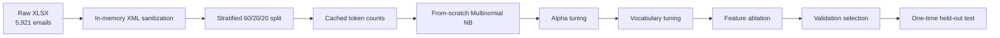
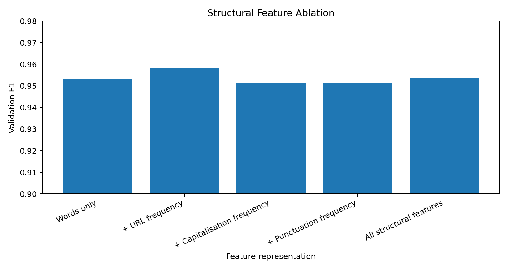

# SpamShield — From-Scratch Email Spam Classifier

A portfolio-ready NLP project that implements **Multinomial Naive Bayes from scratch** and evaluates it on the full **5,921-email de-duplicated SpamAssassin dataset** used in this project.

> No scikit-learn classifier is used. Tokenization, vocabulary construction, class priors, Laplace smoothing, log-likelihood scoring, stratified splitting, model selection, prediction, and evaluation are implemented directly in Python/NumPy.

## Results at a glance

| Item | Result |
|---|---:|
| Dataset | **5,921 emails** |
| Class balance | 4,109 ham / 1,812 spam |
| Split | 3,553 train / 1,184 validation / 1,184 test |
| Best alpha | **2** |
| Best vocabulary size | **10,000 words** |
| Best validation representation | **Words + URL-frequency feature** |
| Validation F1, words only | 95.30% |
| Validation F1, + URL frequency | **95.84%** |
| URL-feature validation F1 lift | **+0.54 percentage points (~+0.57% relative)** |
| Held-out test accuracy | **97.97%** |
| Held-out test precision | **97.74%** |
| Held-out test recall | **95.58%** |
| Held-out test F1 | **96.65%** |
| Held-out confusion counts | TP 346 / TN 814 / FP 8 / FN 16 |

The test set is kept untouched during model selection. Alpha, vocabulary size, and feature representation are chosen only from validation results.

## Scale-up from the prototype

The earlier prototype used 592 emails. This version uses all **5,921 de-duplicated emails**: **+5,329 records, +900.17%, or about 10× the data volume**.

Because the training set is much larger, the search space was also expanded rather than simply reusing the small-sample configuration. The selected setup changed from alpha 0.5 / 1,000 words in the prototype to **alpha 2 / 10,000 words** on the full data.

Under the same deterministic train/validation/test design, held-out accuracy increased from 95.76% to **97.97% (+2.21 pp)** and held-out F1 increased from 92.96% to **96.65% (+3.69 pp)**.

## What this project demonstrates

- **Machine learning fundamentals:** Multinomial Naive Bayes, priors, token likelihoods, Laplace smoothing, log-probability inference.
- **NLP preprocessing:** lowercasing, tokenization, frequency-based bag-of-words representation, vocabulary selection.
- **Feature engineering:** URL-frequency, capitalization-frequency, and punctuation-frequency pseudo-tokens.
- **Experiment design:** deterministic stratified 60/20/20 train-validation-test split, alpha tuning, vocabulary search, feature ablation, untouched held-out test.
- **Data engineering:** direct XLSX ingestion with safe in-memory removal of legacy invalid XML control bytes while preserving the raw workbook unchanged.
- **Evaluation:** accuracy, precision, recall, F1, and confusion counts implemented without scikit-learn.
- **Software engineering:** installable `src/` package, cached experiment runner, saved model, CLI demo, automated tests, reproducible plots, and GitHub Actions CI.

## Experiment pipeline



## Structural feature ablation

| Feature representation | Accuracy | Precision | Recall | F1 |
|---|---:|---:|---:|---:|
| Words only | 97.13% | 95.30% | 95.30% | 95.30% |
| + URL frequency | **97.47%** | 96.11% | **95.58%** | **95.84%** |
| + Capitalisation frequency | 97.04% | 96.06% | 94.20% | 95.12% |
| + Punctuation frequency | 97.04% | 96.06% | 94.20% | 95.12% |
| All structural features | 97.21% | **96.60%** | 94.20% | 95.38% |



## Dataset

The full workbook contains 5,921 exact-text-de-duplicated rows from five complementary SpamAssassin corpus groups:

| Group | Rows |
|---|---:|
| easy_ham | 2,472 |
| easy_ham_2 | 1,389 |
| hard_ham | 248 |
| spam | 481 |
| spam_2 | 1,331 |

The raw workbook contains 102 legacy non-printable XML control bytes embedded in historical email bodies. `spamshield.data.load_xlsx_records` removes only those invalid XML 1.0 bytes **in memory** before parsing, so the source workbook remains unchanged for provenance.

## Repository structure

```text
spamshield-naive-bayes-full/
├── data/
│   ├── README.md
│   └── raw/SpamAssassin_H2_Data_FULL.xlsx
├── src/spamshield/
│   ├── data.py                     # XLSX loader + stratified split
│   ├── features.py                 # tokenizer + structural features
│   ├── model.py                    # from-scratch Multinomial NB
│   ├── metrics.py                  # classification metrics
│   └── experiments.py              # cached experiment runner
├── results/
│   ├── metrics.json                # reproducible evaluation results
│   └── model.json                  # saved selected model
├── assets/                         # experiment figures
├── notebooks/experiment_walkthrough.ipynb
├── tests/                          # automated tests
├── run_experiments.py              # full training/evaluation pipeline
├── demo.py                         # single-email CLI prediction
├── PORTFOLIO_COPY.md               # resume + GitHub copy
└── .github/workflows/tests.yml
```

## Quick start

```bash
git clone <your-repo-url>
cd spamshield-naive-bayes-full
python -m venv .venv
# macOS/Linux: source .venv/bin/activate
# Windows: .venv\Scripts\activate
pip install -e .
python run_experiments.py
```

Classify one email with the saved model:

```bash
python demo.py --text "Congratulations! Claim your free prize at https://example.com"
```

Run tests:

```bash
pip install -r requirements-dev.txt
pytest -q
```

## Design notes

**Why cache token counts?** The full dataset is roughly 10× larger than the prototype. Precomputing document counts avoids repeating the same token aggregation across every alpha, vocabulary, and ablation run without changing the Naive Bayes equations.

**Why log probabilities?** Multiplying many small probabilities can underflow numerically. Summing log-likelihoods is mathematically equivalent for class ranking and is numerically stable.

**Why a separate validation set?** Alpha, vocabulary size, and feature representation are selected on validation F1. The test set stays untouched until the configuration is fixed.

**Why report the URL gain separately?** URL frequency improved validation F1 from **95.30% to 95.84% (+0.54 pp)**. The 97.97% test accuracy is a separate estimate of generalization and is not attributed solely to that feature.

## Limitations

SpamAssassin is an older public corpus and should not be interpreted as a modern production spam benchmark. A production system would require newer data, richer MIME/header parsing, domain reputation signals, multilingual evaluation, calibration, adversarial robustness testing, privacy review, and monitoring for distribution shift.

## Data attribution

Dataset source: Apache SpamAssassin public corpus — https://spamassassin.apache.org/old/publiccorpus/

The MIT license applies to project code only; third-party email content retains its source terms.
